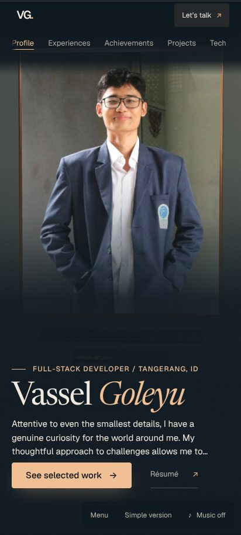
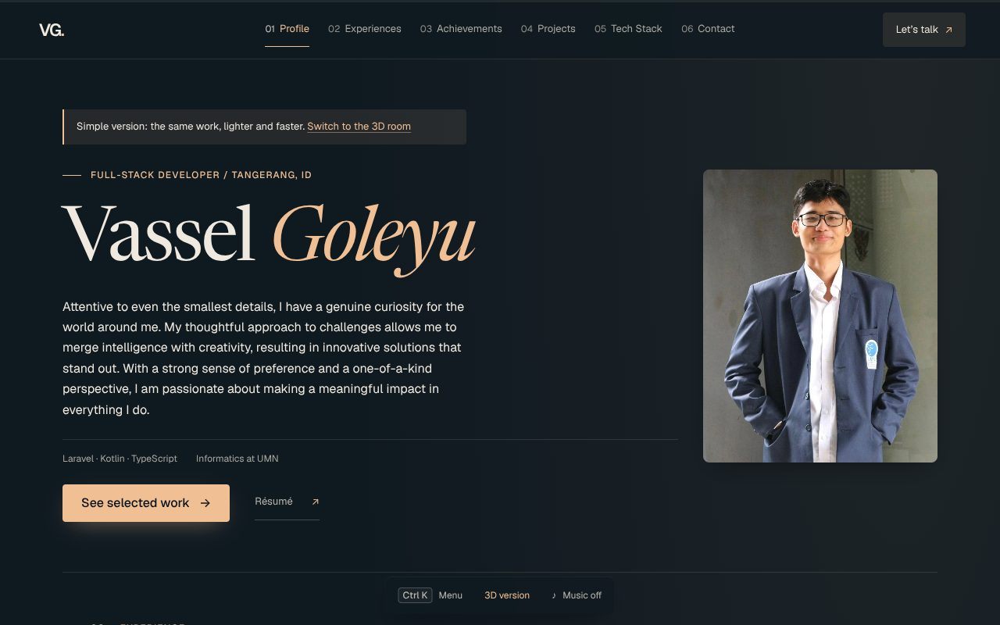
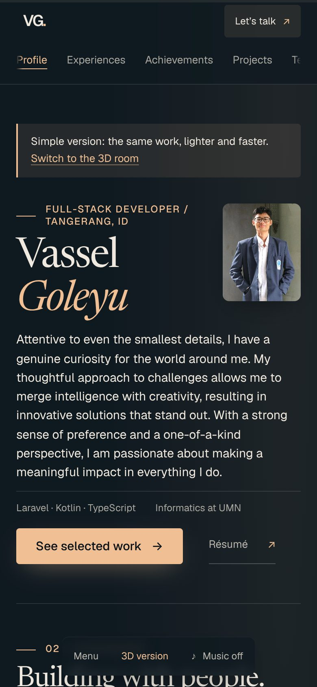

# Vassel Goleyu 3D Portofolio

A scroll-driven 3D portfolio set in a cozy workspace, with a fast reading version for anyone who just wants the content.
Built with React, TypeScript, Vite and React Three Fiber. © Vassel Goleyu.

| 3D room (mobile) | Simple version (desktop) | Simple version (mobile) |
| --- | --- | --- |
|  |  |  |

## Run

```sh
npm install
npm run dev        # local dev server
npm run build      # production build in dist/
npm run preview    # serve dist/ on http://localhost:4173
```

Node 22. Set `VITE_SITE_URL=https://your-domain` at build time to get absolute social-card and canonical URLs plus
`sitemap.xml` and the `Sitemap:` line in `robots.txt`.

## Checks

```sh
npm run check      # lint, typecheck, unit tests, production build
npm run test:e2e   # Playwright + axe against the production build (installs nothing; needs Chromium)
npm run lighthouse -- http://localhost:4173/?view=simple label   # mobile Lighthouse summary into docs/perf/
```

CI (`.github/workflows/ci.yml`) runs lint, typecheck, unit tests, build and the browser tests on every pull request.
Older script-style suites live in `tools/` (`npm run test:flow`, `test:features`, ...) and need a dev server.

## Deploy

Vercel works as is: `vercel.json` sets the Vite build, long-lived caching for hashed assets, and security headers.
Optionally set `VITE_SITE_URL`. `.github/workflows/pages.yml` is a manual GitHub Pages deploy (needs a custom domain or a
user site, because asset paths are root-absolute).

## Features

- Six chapters (Profile, Experiences, Achievements, Projects, Tech Stack, Contact) in a 3D room.
- **Simple version**: the same content as a normal page. It is chosen automatically on Data Saver, on devices with 2 GB
  of memory or less, with no WebGL, or with a software renderer; anyone can switch from the dock or with `?view=simple|3d`.
- **Case studies** for Assay, Paper Trail, Falsify, Hak Data and APEX GYM, written from each repository's own README
  (problem, what it does, evidence, stated limits), with a quick-read index (`#case-studies`).
- Command palette (`Ctrl K`), shareable dialog links, a résumé generated from the same data, `prefers-reduced-motion`.
- Accessibility: skip link, focus trapping in dialogs, keyboard chapter navigation, axe WCAG A/AA tests in both views.

## Architecture

```
index.html            metadata, Open Graph, JSON-LD, noscript content
src/App.tsx           chapters, scroll engine, overlays, simple-version switching
src/data/             portfolio.ts (profile, roles, projects) and caseStudies.ts: the only places content lives
src/scene/            the 3D room and camera journey, loaded lazily (React.lazy) after the HTML interface paints
src/lib/              pure helpers: GitHub parsing, deep links, palette scoring, device capability probe
tests/unit            Vitest      tests/e2e   Playwright + axe
tools/                Lighthouse and 3D measurement scripts, QA journeys, social-card renderer
docs/                 IMPROVEMENT-PLAN.md, perf/ (measurements), screenshots/
```

Why Vite and not Astro: see `docs/IMPROVEMENT-PLAN.md`. The simple version already scores 85-87 on mobile Lighthouse; the
cost is in the 3D work, which a different framework would not remove.

## Content

Every project card, role and case study comes from this repository or from the public READMEs at
github.com/sellebeww. Fields that need the owner's own facts are marked `TODO(vassel)` (for example the role in each case
study); nothing is invented.
